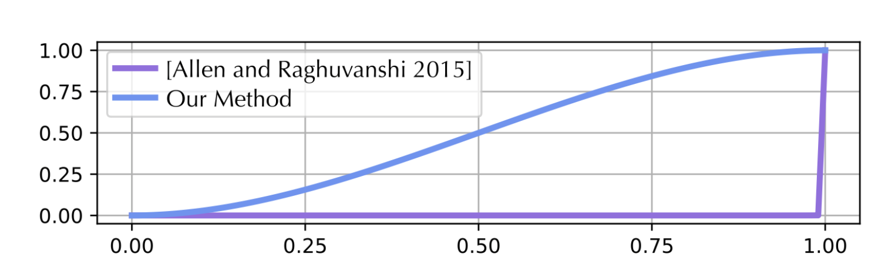

[Original Paper](https://dl.acm.org/doi/full/10.1145/3680528.3687696)

> _In this paper, we present WaveBlender, a simple and fast GPU-accelerated finite-difference time-domain (FDTD) acoustic wavesolver for simulating animation sound sources on uniform grids._

# TL;DR
Starting with the following governing wave equation,
$$
\begin{align}
    \frac{\partial p(\mathbf{x}, t)}{\partial t} &= -\rho_0 c_0^2 \nabla \cdot \mathbf{v}(\mathbf{x}, t) \tag{1a} \\
    \frac{\partial \mathbf{v}(\mathbf{x}, t)}{\partial t} &= -\frac{1}{\rho_0} \nabla p(\mathbf{x}, t) \tag{1b}
\end{align}
$$
For a fast way to apply on-the-fly modifications to geometry (i.e., opening a tone hole, closing a valve or applying a mute), we can define a time-varying dynamic geometry field $\beta \equiv \beta(\mathbf{x}, t)$ bounded between 0 and 1. One way the governing equation can be expresed is,
$$
\begin{equation}
    (1-\beta)\frac{\partial \mathbf{v}(\mathbf{x},t)}{\partial t} + \beta \mathbf{v}(\mathbf{x},t) = -(1-\beta)^2 \frac{1}{\rho_0} \nabla p(\mathbf{x},t) + \beta \mathbf{v}_b(\mathbf{x},t) \tag{6}
\end{equation}
$$

This paper proposes a better way to do this that yields smoother results and can be GPU parallelized.

# Setup

## Acoustic Wave Equation
Consider a scene with objects $\mathcal{O}$, surrounded by an acoustic medium $\Omega$, and let $\Gamma$ denote the boundary of $\mathcal{O}$. 

### PDE
Within the surrounding acoustic medium, $\mathbf{x} \in \Omega$, sound propagation is described by the set of coupled linear wave equations:
$$
\begin{align}
    \frac{\partial p(\mathbf{x}, t)}{\partial t} &= -\rho_0 c_0^2 \nabla \cdot \mathbf{v}(\mathbf{x}, t) \tag{1a} \\
    \frac{\partial \mathbf{v}(\mathbf{x}, t)}{\partial t} &= -\frac{1}{\rho_0} \nabla p(\mathbf{x}, t) \tag{1b}
\end{align}
$$

where $p$ is the pressure perturbation, $\mathbf{v}$ the particle velocity, and $\rho_0$  and $c_0$ are the acoustic medium’s density.

### Boundary Conditions
This varies from problem-to-problem. For example, normal surface accelerations, $a_n$ on $\Gamma$ generate outgoing waves can be modeled using Neumann boundary conditions using the normal component of (1b):
$$
\begin{equation}
    \frac{\partial \mathbf{v}(\mathbf{x},t)}{\partial t} \cdot \hat{\mathbf{n}} = -\frac{1}{\rho_0} \hat{\mathbf{n}} \cdot \nabla p(\mathbf{x},t) \implies a_n = -\frac{1}{\rho_0}\partial_n p(\mathbf{x},t) \tag{2}
\end{equation}
$$

In velocity-level discretizations, we can specify the normal boundary velocity directly:
$$
\begin{equation}
    \mathbf{v}(\mathbf{x},t) \cdot \hat{\mathbf{n}} = v_b(\mathbf{x},t) \qquad \mathbf{x} \in \Gamma \tag{3}
\end{equation}
$$

### Aside: Wha-? Where did that governing equation come from???
The equations below are a first-order (linear) approximation to compressible, inviscid (Euler) flow, using a perturbation-based method.

Sound results from a time-varying perturbation of the dynamic and thermodynamic variables that describe the medium. For sound in fluids (liquids and gases), we distinguish the ambient quantities (i. e., those of the medium in the absence of a disturbance) from the perturbations by the subscript 0 and a prime, respectively. As is conventional in acoustics, the pressure perturbation is written $p$ without a prime.
$$
    \begin{aligned}
        \rho &= \rho_0 + \rho' \\
        P &= P_0 + p \\
        \mathbf v &= \mathbf v_0 + \mathbf v'
    \end{aligned}
$$

We assume that the equilibrium fluid is stationary and spatially uniform:

$$ 
    \frac{\partial\rho_0}{\partial t}=0, \qquad \nabla\rho_0=0, \qquad \nabla P_0=0, \qquad \mathbf v_0=0
$$

where $\nabla P_0=0$ follows from Euler's equation applied to the ambient state. We also assume the perturbations are small, $|\rho'|\ll\rho_0$ and $|\mathbf v'|\ll c$, and drop all terms that are products of two or more perturbations.

The first equation comes from conservation of mass,
$$
    \frac{\partial\rho}{\partial t} + \nabla\cdot(\rho\mathbf v) = 0
$$

For small, reversible, adiabatic (isentropic) perturbations, i. e., neglecting viscosity and heat conduction, a first-order expansion of $P(\rho, s)$ about the ambient state gives
$$
    p = \left(\frac{\partial P}{\partial\rho}\right)_s \rho'
$$

We define the speed of sound $c$ by $c^2 \equiv (\partial P/\partial\rho)_s$, evaluated at the ambient state, so that $\rho' = p/c^2$. Since the ambient state is uniform and stationary, $c$ is constant in space and time. And so, the continuity equation can be rearranged as,
$$
    \begin{aligned}
        \frac{\partial(\rho_0+\rho')}{\partial t} + \nabla\cdot[(\rho_0+\rho')\mathbf v'] &= 0 \\
        \frac{\partial\rho'}{\partial t} + \rho_0\nabla\cdot\mathbf v' &= 0 \\
        \frac{\partial}{\partial t} \left(\frac{p}{c^2}\right) + \rho_0\nabla\cdot\mathbf v' &= 0 \\
        \frac{\partial p}{\partial t} + \rho_0c^2\nabla\cdot\mathbf v' &= 0
    \end{aligned}
$$

where the second line uses $\partial\rho_0/\partial t=0$ and $\nabla\rho_0=0$, and drops the second-order term $\nabla\cdot(\rho'\mathbf v')$. And so, rearranging,
$$
    \boxed{ \frac{\partial p}{\partial t} =-\rho_0c^2\nabla\cdot\mathbf v' }
$$

The second equation comes from momentum balance. For an inviscid fluid with no external body forces, Euler's equation is
$$ 
    \rho\left[ \frac{\partial\mathbf v}{\partial t} + (\mathbf v\cdot\nabla)\mathbf v \right] =-\nabla P
$$

Substituting the separated equations for $\mathbf{v}, P, \text{ and } \rho$ into Euler's equation, using $\nabla P_0=0$, and dropping the terms that are products of perturbations ($\rho'\,\partial\mathbf v'/\partial t$, $\rho_0(\mathbf v'\cdot\nabla)\mathbf v'$, and $\rho'(\mathbf v'\cdot\nabla)\mathbf v'$):
$$
\begin{aligned}
    (\rho_0+\rho') \left[ \frac{\partial\mathbf v'}{\partial t} + (\mathbf v'\cdot\nabla)\mathbf v' \right] &= -\nabla(P_0+p) \\
    \rho_0\frac{\partial\mathbf v'}{\partial t} &= -\nabla p
\end{aligned}
$$

This yields,
$$ 
    \boxed{ \frac{\partial\mathbf v'}{\partial t} =-\frac{1}{\rho_0}\nabla p } 
$$

## Acoustic Blending Scheme
Consider the following modification to the velocity component of the wave equation (1) applied over the entire domain:
$$
\begin{equation}
    (1-\beta)\frac{\partial \mathbf{v}(\mathbf{x},t)}{\partial t} + \beta \mathbf{v}(\mathbf{x},t) = -(1-\beta)^2 \frac{1}{\rho_0} \nabla p(\mathbf{x},t) + \beta \mathbf{v}_b(\mathbf{x},t) \tag{6}
\end{equation}
$$

where $\beta \in [0,1]$. This modification essentially blends between the momentum equation (1b) (when $\beta = 0$) and the enforcement of the normal boundary velocity $\mathbf{v} = \mathbf{v}_b$ (when $\beta = 1$).

## Finite Difference Time-Domain (FDTD)
The FDTD update rule of equations (1a) and (1b) for step $n$ gives the pressure at the center and the velocity on the faces of an air cell at $(i,j,k)$ are:
$$
\begin{align}
    p^{n+1} &= p^n - \rho_0 c_0^2 \left( \tilde{\nabla} \cdot \mathbf{v}^{n+1/2} \right) \Delta t, \tag{4a} \\
    \mathbf{v}^{n+1/2} &= \mathbf{v}^{n-1/2} - \frac{1}{\rho_0} \left( \tilde{\nabla} p^n \right) \Delta t \tag{4b}
\end{align}
$$

Using a semi-implicit scheme, equation (6) can be discretized to give the following velocity update rule:
$$
\mathbf{v}^{n+1/2} = \underbrace{\frac{(1-\beta)\mathbf{v}^{n-1/2} - (1-\beta)^2 \left(\tilde{\nabla}p^n/\rho_0\right)\Delta t}{ (1-\beta)+\beta\Delta t}}_\text{"blended momentum term" (4b)} + \underbrace{w_\beta \mathbf{v}_b^{n+1/2}}_\text{weigh term}. \tag{7}
$$

where $\bar{\nabla}$ denotes the discrete gradient operator. For example, in the x-component of the velocity update:
$$
\bar{\nabla} p_{i+1/2,j,k} = \frac{p_{i+1,j,k} - p_{i,j,k}}{\Delta x}\tag{(5)}
$$

The first term on the right corresponds to the original momentum equation, while the second term is contributed by the boundary condition $\mathbf{v}_b$ with weight 
$
w_\beta = \frac{\beta\Delta t}{(1−\beta) + \beta \Delta t}
$.

# What They Are Proposing
They observed $w_\beta$ is quite steep for when plotted against normalized $t \in [0, 1]$.

They instead blend the discrete formulation rather than the continuous.
$$
\mathbf v^{n+1/2}
= (1-\beta)
\underbrace{\left(
\mathbf v^{n-1/2}
-\frac{\widetilde{\nabla}p^n}{\rho_0}\Delta t
\right)}_{\text{ordinary FDTD update}} +\beta
\underbrace{\mathbf v_b^{n+1/2}}_{\text{boundary condition}}
$$

There are many advantages in doing this,
1. **Smoother transitions:** The boundary condition is introduced gradually and predictably, rather than suddenly taking effect near the end of the transition.

2. **Fewer audio artifacts:** Smoother changes in the velocity field reduce unwanted acoustic discontinuities, clicks, and transient noise as objects move.

3. **Direct control over blending:** The blending parameter \(\beta\) directly determines the contribution of the boundary condition, making it easier to design smooth transitions.

4. **Simple implementation:** It requires only a modification to the existing FDTD velocity update, rather than a completely new solver.

5. **Physically meaningful behavior:** The blended region behaves like an increasingly dense medium as it transitions from air to solid, providing a useful interpretation of the transition.

# References
Andrew Allen and Nikunj Raghuvanshi. 2015. Aerophones in flatland: interactive wave simulation of wind instruments. ACM Trans. Graph. 34, 4, Article 134 (August 2015), 11 pages. [https://doi.org/10.1145/2767001](https://doi.org/10.1145/2767001)